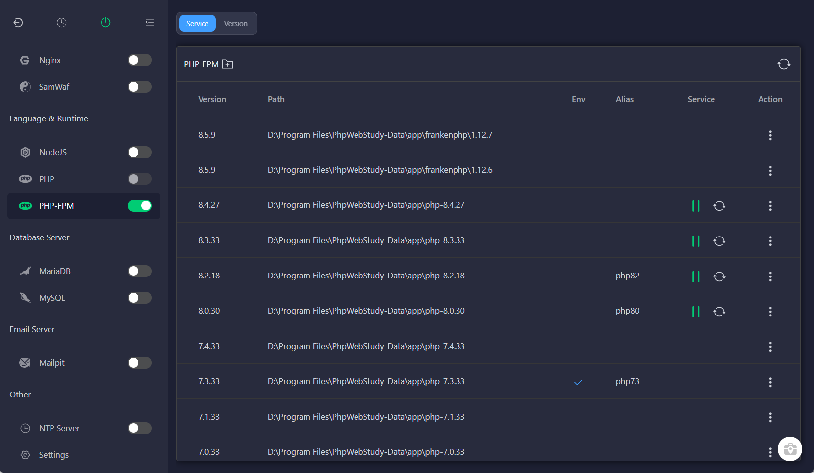
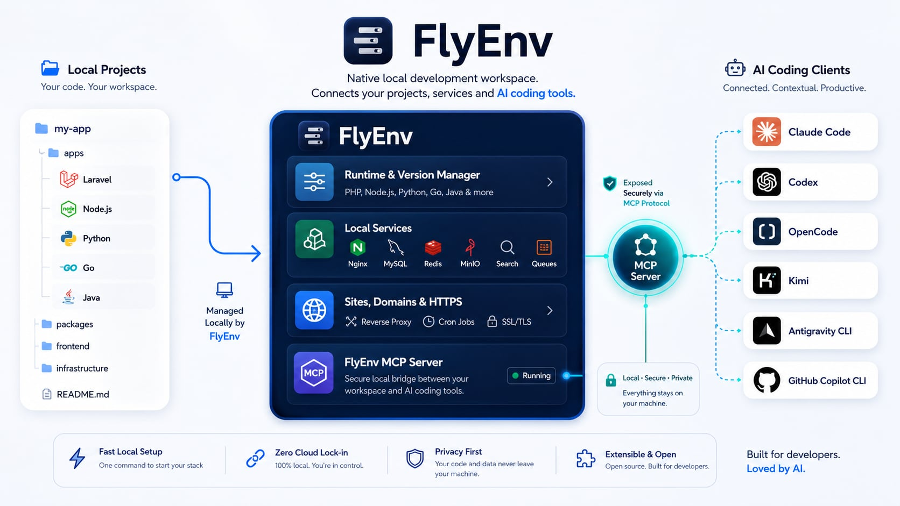
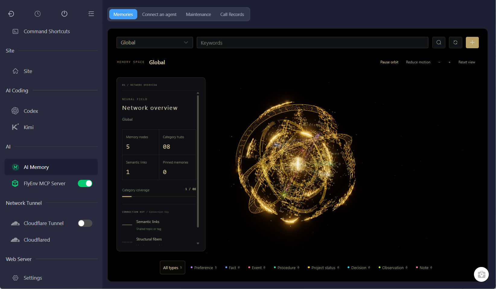

# FlyEnv

<div align="center">
  

<h2>Native Local Development. Extensible Tools. AI-Ready Workflows.</h2>

  <p><strong>FlyEnv is an open-source, native local development environment for Windows, macOS, and Linux.</strong></p>

  <p>Run PHP, Node.js, Python, Java, Go, databases, web servers, and local HTTPS from one desktop app. Add capabilities through the Plugin Market, and give AI coding agents access to your local environment through MCP.</p>

  <p><strong>Broad in capability. Focused in experience.</strong></p>

  <p>
    <a href="https://github.com/xpf0000/FlyEnv/releases"></a>
    <a href="https://github.com/xpf0000/FlyEnv/releases"></a>
    <a href="https://github.com/xpf0000/FlyEnv/blob/master/LICENSE"></a>
  </p>

  <p>
    <a href="https://flyenv.com/download"><strong>Download</strong></a> ·
    <a href="https://flyenv.com/demos"><strong>Watch Demos</strong></a> ·
    <a href="https://flyenv.com/guide/getting-started"><strong>Quick Start</strong></a> ·
    <a href="https://flyenv.com/features"><strong>Explore Features</strong></a>
  </p>
</div>



## Why FlyEnv?

Your local project is more than one language runtime. It also needs databases, services, project commands, domains, and HTTPS. FlyEnv brings them into one native workspace — with no container setup required for everyday local development.

- **Native by default.** Run managed services directly on Windows, macOS, or Linux; use Docker when container reproducibility or production parity is what you need.
- **One project, one working environment.** Switch runtime versions by project and use local domains, HTTPS, and reverse proxies.
- **Start the whole stack together.** Save project and service dependencies in reusable Startup Groups.
- **Extend only when needed.** Add specialized tools from the Plugin Market instead of installing everything up front.
- **Let AI agents work with your environment.** FlyEnv's MCP Server exposes selected local-development operations, while AI Memory can preserve reusable project knowledge across sessions.

## From a project folder to a running local site

For a Laravel project, for example, you may need PHP, MySQL or PostgreSQL, Redis, Node.js, Nginx, and HTTPS. With FlyEnv, you can manage those dependencies in one place, select the runtime versions your project needs, configure its local domain, and save a reusable Startup Group for the next development session.

**[See real project demos](https://flyenv.com/demos)** · **[Learn about Startup Groups](https://flyenv.com/features/startup-groups)** · **[Per-project runtime versions](https://flyenv.com/features/per-project-runtimes)**

## Expand your workspace with the Plugin Market

Start with the runtimes and services you use. Install optional capabilities when a project calls for them. Plugins can add dedicated controls, configuration, version management, and specialized views to FlyEnv — and third-party plugin registry sources are supported.

| What you want to do | Example plugins |
| :--- | :--- |
| Build AI workflows | AI Memory, llama.cpp |
| Test messaging and search | Kafka, OpenSearch |
| Work with specialized databases | SQL Server, Dameng DM8 |
| Test replication or clustering | MySQL Cluster, MariaDB Cluster |
| Add development utilities | SamWaf, NTP Server, Command Shortcuts |

Open **Settings → Plugin Market** to discover, install, enable, disable, or update plugins. Some plugins have operating-system or runtime requirements; check their feature pages first.

**[Explore the Plugin Market](https://flyenv.com/features/plugin-market)** · **[Plugin Development Guide](./plugins/README.md)**

> Installing and updating plugins through the market requires an active FlyEnv license. [See license details](https://flyenv.com/license). The FlyEnv source code is available under the BSD 3-Clause license.


## AI coding agents, connected to your actual local stack

FlyEnv brings AI coding tools and local infrastructure into the same workflow through its built-in MCP Server. Supported clients can use permitted MCP tools to inspect services, versions, sites, configuration, and logs, and perform approved environment operations.

**[Explore FlyEnv MCP Server](https://flyenv.com/features/mcp-server)**



### AI Memory: preserve context across sessions and agents

**AI Memory** is an optional FlyEnv plugin that gives MCP-connected coding agents shared access to persistent local memories. Instead of explaining the same test commands, coding conventions, or architecture decisions in every session, save them once and retrieve them when needed.

- **Persistent across sessions:** keep decisions, facts, preferences, and reusable procedures for later work.
- **Shared across supported agents:** for example, Codex and Claude Code can access memories in the same selected scope.
- **Project-scoped:** keep one project's knowledge separate from another; store cross-project preferences in Global memory.
- **Local management:** search, edit, review revisions and sources, explore the 3D memory map, and back up or restore records.

Install it from **Settings → Plugin Market**, enable the memory tools in **MCP settings**, and use **Connect an agent** to configure a supported coding client. Agents save and retrieve memories through MCP according to their configuration and tool calls; saving is not automatic in every session.



**[Explore AI Memory](https://flyenv.com/features/ai-memory)**


## Built-in runtimes and services

FlyEnv supports a broad local stack, including:

| Category | Examples |
| :--- | :--- |
| Languages & runtimes | PHP, Node.js, Python, Java, Go, Ruby, Rust, .NET, Bun, Deno |
| Web servers | Nginx, Apache, Caddy, FrankenPHP, Tomcat |
| Databases | MySQL, MariaDB, PostgreSQL, MongoDB, ClickHouse, Neo4j, Qdrant |
| Cache & messaging | Redis, Memcached, RabbitMQ |
| Search & infrastructure | Elasticsearch, Meilisearch, Typesense, Consul, Etcd |
| Storage & developer tools | MinIO, RustFS, Mailpit, Cron Jobs, Cloudflare Tunnel |

**[Browse all supported features](https://flyenv.com/features)**

## Download & Installation

Choose the package for your operating system below. The links download the installer or package directly, without requiring you to find the right file on the GitHub Releases page.

### Windows

- **Installer (recommended):** [FlyEnv-Setup-4.21.1.exe](https://github.com/xpf0000/FlyEnv/releases/download/v4.21.1/FlyEnv-Setup-4.21.1.exe)
- **Portable:** [FlyEnv-Portable-4.21.1.exe](https://github.com/xpf0000/FlyEnv/releases/download/v4.21.1/FlyEnv-Portable-4.21.1.exe)

### macOS

**Homebrew:**

```bash
brew install flyenv
```

Or download a disk image directly:

- **Apple Silicon (M1/M2/M3/M4 and newer):** [FlyEnv-4.21.1-arm64.dmg](https://github.com/xpf0000/FlyEnv/releases/download/v4.21.1/FlyEnv-4.21.1-arm64.dmg)
- **Intel:** [FlyEnv-4.21.1.dmg](https://github.com/xpf0000/FlyEnv/releases/download/v4.21.1/FlyEnv-4.21.1.dmg)

### Linux

| Package | x86_64 | ARM64 |
| :--- | :--- | :--- |
| **Debian / Ubuntu (.deb)** | [Download .deb](https://github.com/xpf0000/FlyEnv/releases/download/v4.21.1/FlyEnv-4.21.1-x64.deb) | [Download .deb](https://github.com/xpf0000/FlyEnv/releases/download/v4.21.1/FlyEnv-4.21.1-arm64.deb) |
| **Fedora / RHEL (.rpm)** | [Download .rpm](https://github.com/xpf0000/FlyEnv/releases/download/v4.21.1/FlyEnv-4.21.1-x64.rpm) | [Download .rpm](https://github.com/xpf0000/FlyEnv/releases/download/v4.21.1/FlyEnv-4.21.1-arm64.rpm) |

> **Version:** The direct links above point to **v4.21.1**. For newer versions and other files, visit the [official download page](https://flyenv.com/download) or [GitHub Releases](https://github.com/xpf0000/FlyEnv/releases).

## Getting started

1. Install FlyEnv using the appropriate package above.
2. Install only the runtimes and services your project needs.
3. Add a local site, assign its domain, and enable HTTPS if needed.
4. Configure project-specific versions and a Startup Group for repeatable startup.
5. Optionally install plugins or connect a coding agent through MCP.

**[Full Getting Started Guide](https://flyenv.com/guide/getting-started)**

## Coming from other local development tools?

FlyEnv is a modern native alternative to XAMPP, MAMP, Laragon, and Laravel Herd for developers who work across multiple runtimes and infrastructure services.

| If you use... | FlyEnv may be a fit when you need... |
| :--- | :--- |
| XAMPP / MAMP | More languages, services, project-specific versions, and local workflows |
| Laragon | A similar native workspace across Windows, macOS, and Linux, plus AI/MCP tooling |
| Laravel Herd | An environment that extends beyond PHP and Laravel |
| Docker Desktop | A native local workflow for tasks where container reproducibility is not essential |

FlyEnv is **not a drop-in replacement for Docker**. Choose containers when production parity and reproducibility matter; choose FlyEnv when native local services and a unified desktop workflow better fit the task.

## Open source and contributions

FlyEnv is open source under the **[BSD 3-Clause License](./LICENSE)**. Installation packages are built with [GitHub Actions](https://github.com/xpf0000/FlyEnv/actions). Free Windows code signing is provided by [SignPath.io](https://signpath.io), with the certificate provided by the [SignPath Foundation](https://signpath.org).

To run the project in development:

```bash
git clone git@github.com:xpf0000/FlyEnv.git
cd FlyEnv
yarn install
yarn run dev
```

See the [Development Guide](./DEV.md) and [Plugin Development Guide](./plugins/README.md). Issues and pull requests are welcome.

## Community and support

[Documentation](https://flyenv.com/guide/) · [Demos](https://flyenv.com/demos) · [GitHub Discussions](https://github.com/xpf0000/FlyEnv/discussions) · [Discord](https://discord.gg/u5SuMGxjPE) · [Facebook Group](https://www.facebook.com/groups/908637655411162)

---

**License:** [BSD 3-Clause](./LICENSE) · **Website:** [flyenv.com](https://flyenv.com)
